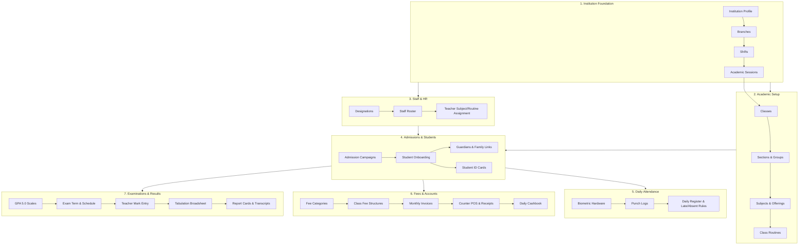

# School Management System (SMS) — Complete Admin Dashboard User Manual & Operational Guide

> **System Overview**
> This system is an enterprise, multi-tenant School Management System tailored for Bangladeshi educational institutions (Primary, High School, College, and Madrasah). It supports bilingual operation (English and Bengali / বাংলা), GPA 5.0 grading, bKash/Nagad/Cash fee collection, biometric hardware terminals, automated SMS dispatches, and full institutional lifecycle management.

---

## Table of Contents
1. [System Architecture & Core Principles](#1-system-architecture--core-principles)
2. [Sequential Setup Guide: What to Create First (Step-by-Step)](#2-sequential-setup-guide-what-to-create-first-step-by-step)
   - [Phase 1: Institution & Academic Foundations](#phase-1-institution--academic-foundations)
   - [Phase 2: Academic Architecture](#phase-2-academic-architecture)
   - [Phase 3: Staff & HR Infrastructure](#phase-3-staff--hr-infrastructure)
   - [Phase 4: Admissions & Student Information System (SIS)](#phase-4-admissions--student-information-system-sis)
   - [Phase 5: Biometric Attendance & Shift Engines](#phase-5-biometric-attendance--shift-engines)
   - [Phase 6: Fee Structures, Invoicing, POS Counter & Cashbook](#phase-6-fee-structures-invoicing-pos-counter--cashbook)
   - [Phase 7: Exams, Mark Entry, Broadsheet & GPA 5.0 Report Cards](#phase-7-exams-mark-entry-broadsheet--gpa-50-report-cards)
   - [Phase 8: Staff Payroll & Automated Payslips](#phase-8-staff-payroll--automated-payslips)
   - [Phase 9: Operations (Homework, Library, Transport, Hostel)](#phase-9-operations-homework-library-transport-hostel)
   - [Phase 10: Communications & Bulk Bangla SMS](#phase-10-communications--bulk-bangla-sms)
   - [Phase 11: Audit Logs, Reporting Engine & Bulk Import](#phase-11-audit-logs-reporting-engine--bulk-import)
3. [Day-to-Day Operations & Workflows](#3-day-to-day-operations--workflows)
4. [Role-Based Access Control (RBAC) Matrix](#4-role-based-access-control-rbac-matrix)
5. [Troubleshooting & Frequently Asked Questions (FAQ)](#5-troubleshooting--frequently-asked-questions-faq)

---

## 1. System Architecture & Core Principles

---

## 2. Sequential Setup Guide: What to Create First (Step-by-Step)

When onboarding a new school or configuring a fresh academic year, **order of dependencies is critical**. Do not attempt to enroll students or create fee invoices before establishing classes, sessions, and designations.

---

### Phase 1: Institution & Academic Foundations
*Navigate via Sidebar: **Institution Structure***

1. **Global Institution Profile** (`/institution/profile`):
   - Set the school name (English and Bengali, e.g. `Dhaka Model College / ঢাকা মডেল কলেজ`).
   - Enter government identifiers: **EIIN Number**, School Code, Board Affiliation (e.g. Dhaka, Chittagong, Madrasah Board).
   - Configure operational settings: Default Timezone (`Asia/Dhaka`), Weekend Days (Friday and/or Saturday), School Contact, and Logo.
2. **Branches / Campuses** (`/institution/branches`):
   - Create at least one Main Branch (e.g., `Main Campus`).
   - If multi-campus, define secondary branches with their individual addresses and contact numbers.
3. **Shifts** (`/institution/shifts`):
   - Define daily operating shifts:
     - **Morning Shift (প্রভাতী শাখা)**: e.g., 07:30 AM – 12:00 PM.
     - **Day Shift (দিবা শাখা)**: e.g., 12:30 PM – 05:00 PM.
   - Configure punch buffer rules: Start punch time, late threshold (e.g. 15 mins), and auto-half-day policy.
4. **Academic Sessions** (`/institution/sessions`):
   - Create the current calendar year (e.g., `Academic Session 2026`).
   - Specify Start Date (`2026-01-01`) and End Date (`2026-12-31`).
   - Mark this session as **Current / Active Session**.

---

### Phase 2: Academic Architecture
*Navigate via Sidebar: **Academics***

1. **Classes** (`/academics/classes`):
   - Create grade levels according to the curriculum: Class 1 through Class 10 (or 11–12 for Colleges; Ibtedayi/Dakhil for Madrasahs).
   - Assign numeric order (e.g., 1, 2, 3...) for automatic promotion sorting.
2. **Sections & Academic Groups** (`/academics/sections`):
   - Under each class, add sections (e.g., `Section A (Padma)`, `Section B (Meghna)`).
   - Set maximum student capacity per section.
   - For Classes 9–12, configure Academic Groups: `Science (বিজ্ঞান)`, `Humanities (মানবিক)`, `Business Studies (ব্যবসায় শিক্ষা)`.
3. **Subjects & Curriculum Offerings** (`/academics/subjects`):
   - Define subject master list: Subject Code, Bangla & English name (e.g., `101 - Bangla 1st Paper`, `107 - English 1st Paper`, `109 - General Mathematics`).
   - Select subject types: **Compulsory (আবশ্যিক)**, **Elective / Group Optional (নৈর্বাচনিক)**, or **4th Subject (চতুর্থ বিষয়)**.
   - Assign subjects to specific classes and sections.
4. **Class Routine & Timetable** (`/academics/routines`):
   - Define periods (e.g., Period 1: 08:00–08:45, Period 2: 08:45–09:30).
   - Build daily schedules (Sunday through Thursday) by assigning Class + Section + Subject + Room + Teacher.

---

### Phase 3: Staff & HR Infrastructure
*Navigate via Sidebar: **Staff & HR***

1. **Designations & Departments** (`/staff/designations`):
   - Configure hierarchical staff designations: Principal, Vice Principal, Assistant Headmaster, Senior Teacher, Assistant Teacher, Accountant, Office Assistant, Guard, Peon.
   - Group them under Departments: Academic, Administration, Accounts, Support Staff.
2. **Staff Onboarding & Directory** (`/staff/onboarding`, `/staff/list`):
   - Onboard teaching and non-teaching personnel:
     - Full Name, Gender, Blood Group, National ID (NID).
     - Official Mobile Phone (starts with `+8801...`).
     - Employee ID / Bio PIN (must match the Biometric Machine ID).
     - Designation, Department, Branch, Shift, and Joining Date.
     - Monthly basic salary structure and bank account details.
3. **Teacher Subject Assignment**:
   - Link teachers to their respective subjects and sections configured in Phase 2.
4. **Staff Leave Policies** (`/staff/leaves`):
   - Define annual leave quotas: Casual Leave (CL: 14 days), Medical Leave (ML: 10 days), Maternity Leave.
   - Set up leave approval workflows.
5. **Staff Identity Cards** (`/staff/id-cards`):
   - Print high-resolution CR80 plastic identity cards with barcode/QR code for physical campus access.

---

### Phase 4: Admissions & Student Information System (SIS)
*Navigate via Sidebar: **Admissions** and **Students***

1. **Admission Campaigns (New Intake)** (`/admissions/campaigns`):
   - Set up admission circulars for the new academic session.
   - Configure application fees, start/end dates, and required documents.
   - Review submitted applicant profiles, enter admission test marks or conduct lottery, and convert successful applicants into students with one click.
2. **Student Roster & Profiles** (`/students/list`, `/students/admit`):
   - Alternatively, add existing or direct admissions:
     - Student Full Name (English and Bengali), Date of Birth, Gender, Religion, Blood Group.
     - Admission Number, Roll Number, Class, Section, and Shift.
     - Student Biometric Enrollment ID (for biometric cards/fingerprint).
3. **Guardians & Family Contacts** (`/students/guardians`):
   - Record Father's Name, Mother's Name, and Legal Guardian.
   - **Guardian Primary Mobile Number** (`+8801XXXXXXXXX`): Critical for automated SMS delivery (attendance alerts, dues, exam results).
4. **Batch Student ID Cards** (`/students/id-cards`):
   - Generate printable ID cards featuring school banner, student photo, roll, section, blood group, emergency contact, and scannable barcode.

---

### Phase 5: Biometric Attendance & Shift Engines
*Navigate via Sidebar: **Biometric Attendance***

1. **Hardware Terminals & Device Setup** (`/devices/terminals`):
   - Register campus biometric terminals (ZKTeco, Hikvision, Dahua, Anviz RFID/Face/Fingerprint).
   - Configure device IP address, Port, Terminal serial number, and physical location (e.g. `Main Gate - In`, `Academic Building - Out`).
2. **Device Sync & Raw Punch Logs** (`/attendance/logs`):
   - Terminals push live punch records into the system. Monitor incoming punch timestamps.
3. **Daily Attendance Processing** (`/attendance/daily`):
   - The engine automatically aggregates daily punches against student and staff shift schedules:
     - **Present (P)**: Punched before late threshold.
     - **Late (L)**: Punched within late grace period (e.g. 15 mins after shift start).
     - **Half-Day (H)**: Punched after cutoff or left early.
     - **Absent (A)**: No valid punch recorded before shift end.
4. **Manual Attendance Register & Adjustments** (`/attendance/daily`, `/attendance/corrections`):
   - Teachers can open the Class Register to take manual attendance or review punch statuses.
   - Process approved leave requests or manual punch corrections with administrative audit reasons.

---

### Phase 6: Fee Structures, Invoicing, POS Counter & Cashbook
*Navigate via Sidebar: **Fees & Billing***

1. **Fee Categories** (`/fees/categories`):
   - Create institutional fee heads: Monthly Tuition (মাসিক বেতন), Admission Fee, Session Charge, Exam Fee, Transport Fee, Lab Fee, Sports Fee, Late Fine.
2. **Fee Structures by Class** (`/fees/structures`):
   - Create class-specific billing plans for the session (e.g. `Class 9 Science - 2026`).
   - Allocate specific monthly amounts and due dates.
3. **Scholarships & Student Waivers** (`/fees/waivers`):
   - Configure fee concessions: Sibling Discount (25%), Merit Scholarship (100%), Freedom Fighter Quota, or Poor Student Fund.
   - Apply waiver as either percentage or fixed BDT deduction against specific fee categories.
4. **Monthly Invoice Generation** (`/fees/invoices`):
   - Run the automated bulk invoice generator at the start of each month or term.
   - The engine automatically calculates the gross fees, applies valid student waivers, adds overdue late fees, and creates individual invoices.
5. **Counter POS Fee Collection** (`/fees/collection`):
   - Cashier workflow:
     1. Search student by Roll Number, Admission ID, or Student Name.
     2. View pending dues and select invoices to collect.
     3. Select Payment Method: **Cash**, **bKash**, **Nagad**, or **Bank Slip**.
     4. Collect payment and generate instant **3-Part Money Receipt** (Student Copy, Office Copy, Accounts Copy) formatted with BDT (৳) and Bengali words.
6. **Due Defaulters & SMS Follow-up** (`/fees/defaulters`):
   - View class-wise defaulter lists.
   - Dispatch one-click bulk SMS notices to parents with exact due balance and deadline.
7. **Cashbook & Day Book** (`/accounting/cashbook`):
   - View daily opening cash balance, counter fee receipts, expenditure vouchers, bank deposits, and closing balance.

---

### Phase 7: Exams, Mark Entry, Broadsheet & GPA 5.0 Report Cards
*Navigate via Sidebar: **Examinations & Results***

1. **Grading System & GPA 5.0 Scales** (`/exams/grading`):
   - Configure the Bangladeshi National Curriculum Grading Scale:
     - 80% – 100%: **A+** (GP: 5.0)
     - 70% – 79%: **A** (GP: 4.0)
     - 60% – 69%: **A-** (GP: 3.5)
     - 50% – 59%: **B** (GP: 3.0)
     - 40% – 49%: **C** (GP: 2.0)
     - 33% – 39%: **D** (GP: 1.0)
     - 00% – 32%: **F** (GP: 0.0)
2. **Exam Lifecycle Setup** (`/exams/list`):
   - Create exam sessions: `First Term Exam 2026`, `Mid-Term Exam`, `Annual / Final Exam 2026`.
   - Configure subject mark breakdown: CQ (Creative Question), MCQ (Multiple Choice), Practical, and Continuous Assessment (CA) with independent pass marks.
3. **Admit Cards & Hall Passes** (`/exams/admit-cards`):
   - Set clearance prerequisites (e.g. minimum 75% attendance and no outstanding fee dues).
   - Generate and print batch Exam Admit Cards with seat plans.
4. **Teacher Mark Entry Desk** (`/exams/marks`):
   - Subject teachers enter component-wise student marks.
   - The interface validates that entered marks do not exceed maximum values and auto-highlights failing components.
5. **Master Tabulation Sheet / Broadsheet** (`/results/tabulation`):
   - Process examination results across the entire section.
   - View complete broadsheet displaying individual subject marks, total marks, GPA (without 4th subject), optional 4th subject bonus points (>2.0 added to total), final GPA (capped at 5.0), and class rank.
6. **Student Report Cards / Academic Transcripts** (`/results/report-cards`):
   - Print institutional grade sheets and report cards complete with school crest, grading criteria, teacher remarks, attendance percentages, and headmaster's signature.

---

### Phase 8: Staff Payroll & Automated Payslips
*Navigate via Sidebar: **Staff & HR -> Payroll***

1. **Salary Structures** (`/payroll/structures`):
   - Define allowance rules: Basic Pay, House Rent (e.g. 40%), Medical Allowance, Conveyance Allowance, Festival Bonus (Eid/Puja).
   - Configure deduction rules: Provident Fund (PF), Advance Salary, and Late Attendance penalty.
2. **Biometric Attendance-Linked Payslips** (`/payroll/payslips`):
   - Generate monthly payroll runs.
   - The engine checks staff attendance records from Phase 5 and automatically calculates deductions for unapproved absences or excessive late punches.
3. **Disbursement & Bank Advice** (`/payroll/disbursement`):
   - Print cash disbursement registers or export bank advice schedules for direct account-to-account salary transfers.

---

### Phase 9: Operations (Homework, Library, Transport, Hostel)
*Navigate via Sidebar: **Operations***

1. **Homework & Coursework** (`/operations/homework`):
   - Teachers publish assignments with class, section, subject, submission deadline, and attachments.
   - Review submitted student work, assign marks, and provide feedback.
2. **Library Catalog & Circulation** (`/operations/library/books`, `/operations/library/circulation`):
   - Maintain the school book inventory with Dewey decimal call numbers and ISBNs.
   - Issue books to students/staff with due dates; manage returns and track overdue fines in BDT (৳).
3. **Transport Fleet & Routes** (`/operations/transport/vehicles`, `/operations/transport/routes`):
   - Maintain vehicles (Buses, Vans) with BRTA registration numbers, driver details, and fitness/tax token expiry alerts.
   - Configure routes, pickup stops, timing, and monthly transport fee tariffs.
4. **Hostel Dormitories & Beds** (`/operations/hostel/rooms`, `/operations/hostel/allocations`):
   - Manage dorm buildings and rooms with live bed status (`free`, `occupied`, `maintenance`).
   - Check in student boarders, allocate beds, and issue warden-approved gate passes for campus leave.

---

### Phase 10: Communications & Bulk Bangla SMS
*Navigate via Sidebar: **Communications***

1. **SMS Gateway Hub** (`/communications/gateways`):
   - Connect BTRC-approved SMS aggregators: **SSL Wireless**, **Greenweb**, **Banglalink**, **Grameenphone**, **Robi**, **Teletalk**.
   - View live account SMS credit balances and delivery receipts (DLR).
2. **Bulk Bangla Campaign Composer** (`/communications/sms`):
   - Target recipient audiences: All Guardians, All Staff, Specific Class/Section, or Custom mobile numbers.
   - Type in Bengali or English. The editor features a real-time character counter and billing segment calculator (Bangla UTF-16: 70/67 chars per SMS; English GSM-7: 160/153 chars per SMS).
   - Insert dynamic placeholders: `{{student_name}}`, `{{class_name}}`, `{{due_amount}}`, `{{exam_gpa}}`.
3. **Notice Board & Academic Calendar** (`/communications/notices`, `/communications/events`):
   - Publish institutional notices for students, guardians, or teachers with file attachments.
   - Maintain the school calendar marking public holidays, Ramadan/Eid/Puja vacations, and sports events.

---

### Phase 11: Audit Logs, Reporting Engine & Bulk Import
*Navigate via Sidebar: **Reports & Analytics** and **Audit Trail***

1. **Audit Logs & Diff Inspector** (`/audit/logs`):
   - Review immutable system audit records for every record creation, modification, or deletion.
   - Inspect the **Change Diff Modal** to view exact before vs. after JSON changes, operator username, IP address, and timestamp.
2. **User Operational Activity Stream** (`/audit/activities`):
   - Track user logins, export requests, payment status modifications, and privilege changes.
3. **Dynamic Report Builder** (`/reports/definitions`):
   - Build custom institutional reports across 5 core datasets: `Students`, `Daily Attendance`, `Fee Invoices`, `Fee Payments`, `Exam Results`.
   - Select required columns, apply filters, and trigger immediate exports.
4. **Export Jobs & File Downloads** (`/reports/exports`):
   - Monitor asynchronous export tasks and download generated files in **PDF**, **Excel (.xlsx)**, or **CSV** formats.
5. **Bulk Data Importer** (`/reports/imports`):
   - Download the official CSV import template for Students or Staff.
   - Upload filled CSV data with **Dry-Run Validation** enabled.
   - Review validation analysis breakdown (valid rows vs. row-by-row error logs) before committing data to the database.

---

## 3. Day-to-Day Operations & Workflows

### Daily Morning Routine (07:30 AM – 10:00 AM)
1. **Gate Ingestion**: Hardware biometric machines automatically stream punches into the system as students and teachers arrive.
2. **Late & Absent Check**: At cutoff time (e.g., 09:30 AM), the attendance task runs. The administrator checks `/attendance/daily` to review absent students.
3. **Absence Alert Dispatch**: The system automatically dispatches SMS notifications to guardians of absent students:
   `"অভিভাবক, আপনার সন্তান [Student Name] আজ বিদ্যালয়ে অনুপস্থিত আছে।"`

### Daily Financial Routine (09:00 AM – 03:00 PM)
1. **Counter Fee Collection**: Cashiers keep `/fees/collection` open. As parents pay fees, cashiers collect payment, print the 3-part money receipt, and hand the student copy to the parent.
2. **Day End Balancing**: At 04:00 PM, the cashier opens `/accounting/cashbook`, prints the Day Book summary, and verifies physical cash against the registered total.

### Term Exam Routine (Exam Week)
1. **Admit Cards**: Export batch admit cards for students with cleared fee accounts (`/exams/admit-cards`).
2. **Mark Entry**: Subject teachers log in to the portal and enter marks in `/exams/marks`.
3. **Results Publishing**: Headmaster reviews the class Tabulation Broadsheet (`/results/tabulation`), approves results, and prints Report Cards (`/results/report-cards`).
4. **Result SMS**: Send bulk SMS to parents with their child's GPA and letter grade.

---

## 4. Role-Based Access Control (RBAC) Matrix

| Module / Feature | Super Admin | Headmaster / Principal | Accountant | Teacher | Operator / Clerk |
|---|:---:|:---:|:---:|:---:|:---:|
| Institution Settings & Branches | Full | View | No | No | No |
| Academic Sessions & Routines | Full | Full | View | View | View |
| Staff Directory & Payroll | Full | Full | Payroll Only | Profile Only | No |
| Student Admissions & SIS | Full | Full | View | View | Full |
| Biometric Attendance & Register | Full | Full | View | Mark Register | View |
| Fees, Billing & Invoicing | Full | Full | Full | No | Collect Only |
| Cashbook & Accounting | Full | Full | Full | No | View Cash |
| Exams, Marks & Tabulation | Full | Full | No | Enter Marks | View |
| Report Cards & Transcripts | Full | Full | No | View | Print |
| SMS Campaigns & Notices | Full | Full | Dues SMS | View | No |
| Operations (Library, Fleet, Hostel) | Full | Full | No | No | Full |
| Audit Trail & Bulk Importer | Full | View | No | No | No |

---

## 5. Troubleshooting & Frequently Asked Questions (FAQ)

### Q1: Why is a student not appearing in the Fee Invoicing list?
- **Cause**: The student is either marked inactive (`is_active=False`) or is not enrolled in an active section for the selected Academic Session.
- **Fix**: Open `/students/list`, search for the student, verify that their status is Active, and confirm their assigned Class and Section.

### Q2: Why did an SMS campaign not deliver?
- **Cause**: Insufficient SMS credits with the gateway provider or invalid recipient phone numbers.
- **Fix**: Open `/communications/gateways`, click **Check Balance** to verify your live credit count. Ensure numbers are formatted as 11-digit Bangladeshi mobile numbers (`01XXXXXXXXX` or `+8801XXXXXXXXX`).

### Q3: Why does a student's GPA show 0.00 (F) on the Report Card despite passing all other subjects?
- **Cause**: In the Bangladeshi national curriculum, failing in even a single compulsory subject results in an overall GPA of 0.00 (Grade F).
- **Fix**: Check the Tabulation Broadsheet (`/results/tabulation`). Verify if the student obtained less than the pass mark in any subject or component (e.g. MCQ or Practical).

### Q4: How do I change the system language to Bengali?
- **Fix**: Click on the language switcher button located in the top-right header of the dashboard to toggle between **English (EN)** and **বাংলা (BN)**. All menus, tables, buttons, and badges update instantly.
