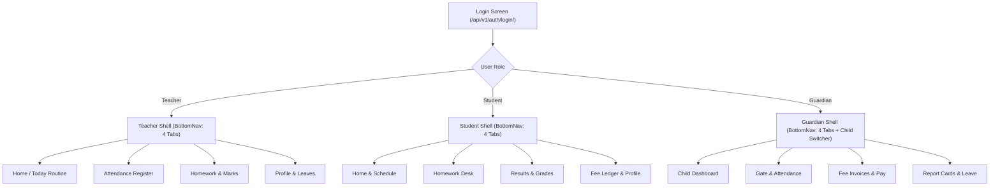
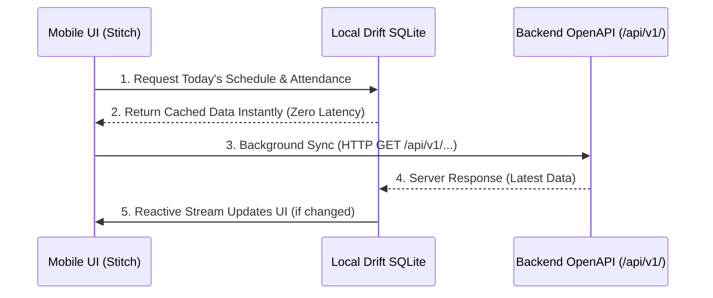

# Mobile UI Design & Generation Specification for Google Stitch
## School Management System (Bangladesh) — Multi-Role Flutter App

> **Target Platform:** Flutter (Android & iOS) via Google Stitch UI Generation
> **Target Audience:** **Teacher**, **Student**, **Guardian / Parent**
> **API Source of Truth:** OpenAPI 3.0 Schema (`schema/schema.yml` / `/api/v1/`)
> **Design Language:** Modern Material 3 with Bangladeshi Localization (English & Bengali / বাংলা, BDT ৳, Asia/Dhaka Time, CR80 / GPA 5.0 standards)

---

## 1. Design System & Global Visual Tokens for Stitch

Google Stitch should apply these design tokens consistently across all generated screens:

### 1.1 Color Palette
```json
{
  "light": {
    "primary": "#1E40AF",         // Deep Institutional Indigo
    "on_primary": "#FFFFFF",
    "primary_container": "#DBEAFE",
    "secondary": "#059669",       // Emerald Green (Success, Pass, Present)
    "on_secondary": "#FFFFFF",
    "tertiary": "#D97706",        // Amber (Late, Pending, Warning)
    "error": "#DC2626",           // Rose Red (Absent, Defaulter, Fail)
    "background": "#F8FAFC",      // Off-white Slate
    "surface": "#FFFFFF",
    "surface_variant": "#F1F5F9",
    "outline": "#E2E8F0",
    "text_primary": "#0F172A",
    "text_secondary": "#64748B"
  },
  "dark": {
    "primary": "#3B82F6",
    "on_primary": "#0F172A",
    "primary_container": "#1E3A8A",
    "secondary": "#10B981",
    "tertiary": "#F59E0B",
    "error": "#EF4444",
    "background": "#0F172A",
    "surface": "#1E293B",
    "surface_variant": "#334155",
    "outline": "#475569",
    "text_primary": "#F8FAFC",
    "text_secondary": "#94A3B8"
  }
}
```

### 1.2 Typography & Localization
- **English Font:** `Inter` or `Roboto` (Medium 500 for headers, Regular 400 for body)
- **Bangla Font:** `Hind Siliguri` or `Noto Sans Bengali`
- **Bangla Digits:** Toggleable converter for dates and currency (e.g., `৳ ১,২৫০.০০` vs `৳ 1,250.00`).
- **Minimum Tap Target:** 48 × 48 dp.
- **Card Corners:** `BorderRadius.circular(16.0)` with subtle drop shadow `BoxShadow(color: Color(0x0A000000), blurRadius: 8, offset: Offset(0, 2))`.

---

## 2. Authentication & Multi-Role Navigation Shells



### 2.1 Common Header & Role-Based Bottom Navigation

#### Top App Bar (Universal)
- **Leading:** School Circular Logo (`User.institution.logo` or placeholder) + School Name / Branch title.
- **Title (for Guardian role only):** **Active Child Selector Pill** dropdown (`[Child Avatar] Safwan - Class 8A ▾`). Switching this updates the global Riverpod `selectedChildProvider` and refreshes all tabs.
- **Actions:**
  - Language toggle button (`EN` | `বাং`).
  - Notification Bell with unread badge counter (`GET /api/v1/communications/notices/`).
  - User avatar with status indicator.

---

## 3. TEACHER MOBILE UI SPECIFICATION

### Persona & Core Jobs-to-be-Done
Teachers need fast, one-handed operation between classes: view today's periods, take attendance in 60 seconds with offline support, assign homework by taking a camera photo of the blackboard, enter exam marks, and apply for leave.

---

### Screen T1: Teacher Home & Today's Schedule
**Route:** `/teacher/home`
**Layout Blueprint:**
1. **Header Banner:** Welcome greeting (`"শুভ সকাল, আহমেদ স্যার"`), Date in Asia/Dhaka (`Sunday, 15 Nov 2026`), and Teacher's Today Punch Badge (`Checked-in: 07:45 AM • On-Time`).
2. **Current / Next Class Hero Card:**
   - Highlights the ongoing or upcoming period (e.g. `Period 2: 09:15 AM - 10:00 AM`).
   - Details: `Class 9 Science` • `General Mathematics` • `Room 302`.
   - Action Button: `[Take Attendance Now]` (One-tap shortcut to Screen T2).
3. **Full Today Routine (Horizontal or Vertical Stepper):**
   - Displays all periods for the day with subject, class, room, and start/end time.
4. **Quick Shortcuts Grid (2 × 2 Cards):**
   - `[📝 Give Homework]` • `[📊 Enter Marks]` • `[📅 My Leaves]` • `[📢 Notice Board]`.

**OpenAPI Integration:**
- **Teacher Attendance Status:**
  - `GET /api/v1/attendance/daily/?staff_id={current_user.staff_id}&date={today}`
  - Schema: `PaginatedDailyAttendanceList`
  - Fields: `status` (`present`, `late`, `absent`), `check_in_time`, `check_out_time`.
- **Today's Class Routine:**
  - `GET /api/v1/academics/routines/?teacher_id={current_user.staff_id}&day={today_weekday}`
  - Schema: `PaginatedRoutineList`
  - Fields: `period.name`, `period.start_time`, `period.end_time`, `class_name`, `section_name`, `subject_name`, `room_number`.

---

### Screen T2: Rapid Class Attendance Register
**Route:** `/teacher/attendance/register`
**Layout Blueprint:**
1. **Context Selector Bar:** Class (`Class 9`), Section (`Section A`), Date (`Today`).
2. **Quick Metric Summary Chips:** Total: 45 • Present: 41 (Green) • Absent: 3 (Red) • Late: 1 (Amber).
3. **Bulk Action Header:** `[Mark All Present]` button for 1-tap baseline.
4. **Student List Tiles (Optimized for Fast Thumbs):**
   - Avatar / Roll number badge (e.g. `Roll: 01`).
   - Student Name (Bangla + English).
   - 3-Segment Segmented Button or Toggle Chips:
     - `[ P ]` (Green fill when active)
     - `[ L ]` (Amber fill when active)
     - `[ A ]` (Red fill when active)
5. **Bottom Floating Action Bar:**
   - Sticky `[Submit Attendance & Trigger SMS]` button.
   - Shows sync state: `Synced` (Green check) or `Offline (Saved locally, will sync when online)` (Cloud upload icon).

**OpenAPI Integration:**
- **Fetch Class Students:**
  - `GET /api/v1/students/?class_id={class_id}&section_id={section_id}&status=active`
  - Schema: `PaginatedStudentList`
  - Fields: `id`, `roll_number`, `first_name`, `last_name`, `photo`.
- **Submit Attendance Register:**
  - `POST /api/v1/attendance/daily/bulk_mark/`
  - Request Body:
    ```json
    {
      "date": "2026-11-15",
      "class_id": "uuid",
      "section_id": "uuid",
      "records": [
        { "student_id": "uuid-1", "status": "present" },
        { "student_id": "uuid-2", "status": "late", "late_minutes": 10 },
        { "student_id": "uuid-3", "status": "absent", "remarks": "Unexcused" }
      ],
      "trigger_sms": true
    }
    ```
  - Response: `201 Created` with summary `{ "total": 45, "present": 41, "absent": 3, "late": 1 }`.

---

### Screen T3: Homework & Coursework Studio
**Route:** `/teacher/homework` & `/teacher/homework/create`
**Layout Blueprint:**
1. **Tabs:** `Active Assignments` | `Past / Closed` | `Drafts`.
2. **Assignment Cards:**
   - Class & Subject badge (e.g. `Class 8 • General Science`).
   - Title, Due Date countdown (`Due in 2 days • 18 Nov`), and Submission Counter (`38 / 45 Submitted`).
3. **Create Assignment FAB (`+`):**
   - Bottom sheet / Full screen form:
     - Dropdown: Class & Section, Subject.
     - Title & Description text areas.
     - Maximum Marks input (e.g. `20`).
     - Due Date & Submission Deadline Timepicker.
     - Late Submission Allowed Switch.
     - Attachment Picker: Camera (snap blackboard/book page), Gallery, or PDF document.
4. **Review Submissions Screen (`/teacher/homework/:id/submissions`):**
   - Student list with status: `Submitted (On Time)`, `Submitted (Late)`, `Pending`.
   - Tap student: View submitted image/PDF full-screen with zoom.
   - Grade Modal: Input Obtained Marks (`/ 20`) + Teacher remarks / feedback.

**OpenAPI Integration:**
- **List Homework:**
  - `GET /api/v1/homework/?assigned_by={teacher_staff_id}`
  - Schema: `PaginatedHomeworkList`
- **Create Homework:**
  - `POST /api/v1/homework/` (multipart/form-data)
  - Fields: `title`, `description`, `class_id`, `section_id`, `subject_id`, `due_date`, `max_marks`, `attachments`.
- **Grade Submission:**
  - `POST /api/v1/homework/submissions/{submission_id}/grade/`
  - Body: `{ "marks_obtained": 18.5, "feedback": "Well written, improve handwriting." }`

---

### Screen T4: Teacher Mark Entry Desk
**Route:** `/teacher/marks/entry`
**Layout Blueprint:**
1. **Selectors:** Exam Term (`Mid-Term 2026`), Class & Section (`Class 10 A`), Subject (`Physics 1st Paper`).
2. **Component Marks Table / Card List:**
   - Student Roll & Name.
   - 3 inline numeric text fields with max limit labels:
     - `CQ (Creative /50)`
     - `MCQ (/25)`
     - `Practical (/25)`
   - Auto-computed Total (`/100`) + Letter Grade badge (`A+`, `A`, `F`).
   - Real-time boundary check: If input > max marks, highlight border red with tooltip error.
3. **Bottom Bar:**
   - `[Save Draft]` button (local/server draft) & `[Final Submit to Controller]`.

**OpenAPI Integration:**
- **Fetch / Submit Marks:**
  - `GET /api/v1/exams/marks/?exam_id={id}&subject_id={id}&section_id={id}`
  - `POST /api/v1/exams/marks/bulk_entry/`
  - Body:
    ```json
    {
      "exam_id": "uuid",
      "subject_id": "uuid",
      "marks": [
        { "student_id": "uuid-1", "cq": 42.5, "mcq": 22.0, "practical": 23.0 },
        { "student_id": "uuid-2", "cq": 28.0, "mcq": 15.0, "practical": 20.0 }
      ]
    }
    ```

---

## 4. STUDENT MOBILE UI SPECIFICATION

### Persona & Core Jobs-to-be-Done
Students need an engaging, intuitive interface to track their daily academic schedule, submit assignments on time, monitor their attendance streak, view exam schedules and GPA 5.0 report cards, and check library books.

---

### Screen S1: Student Home & Academic Feed
**Route:** `/student/home`
**Layout Blueprint:**
1. **Student Hero Profile Card:**
   - Photo, Full Name, Class & Section (`Class 8 - Padma`), Roll Number (`Roll: 05`).
   - Attendance Streak Pill: `🔥 96% Attendance (22/23 days this month)`.
2. **Today's Class Schedule (Timeline):**
   - Current Period banner (highlighted in primary indigo).
   - Time, Subject, Teacher Name, and Room number.
3. **Pending Homework Alert Box:**
   - Warning banner: `⚠️ 2 Homework Due Tomorrow!`.
4. **Notice Board Carousel:**
   - Urgent institutional circulars, holiday announcements, and exam schedules.

**OpenAPI Integration:**
- **Student Profile:**
  - `GET /api/v1/students/{current_user.student_id}/`
  - Schema: `StudentDetail`
- **Student Today Schedule:**
  - `GET /api/v1/academics/routines/?class_id={student.class_id}&section_id={student.section_id}&day={today}`
  - Schema: `PaginatedRoutineList`

---

### Screen S2: Student Homework Desk
**Route:** `/student/homework`
**Layout Blueprint:**
1. **Filter Segment:** `To-Do` | `Submitted` | `Graded`.
2. **Homework Card:**
   - Subject Chip (`General Mathematics`) + Deadline Badge (`Due: Tomorrow, 11:59 PM`).
   - Title, teacher instructions, and attached worksheet preview (PDF/Image thumbnail).
3. **Submission Action:**
   - `[Upload My Solution]` button.
   - File attachment bottom sheet: Camera snapshot of notebook pages, image gallery, or document picker.
   - Text comment box for teacher.
   - Once graded: Displays Marks Pill (e.g. `18 / 20 • Excellent`) and teacher's written remarks.

**OpenAPI Integration:**
- **Student Homework List:**
  - `GET /api/v1/homework/?class_id={student.class_id}&section_id={student.section_id}`
  - Schema: `PaginatedHomeworkList`
- **Submit Solution:**
  - `POST /api/v1/homework/{id}/submit/` (multipart/form-data)
  - Body: `student_id`, `submission_file`, `student_remarks`.

---

### Screen S3: Examinations & GPA 5.0 Report Cards
**Route:** `/student/results`
**Layout Blueprint:**
1. **Active Exam Term Selector:** Dropdown (`First Term 2026`, `Mid-Term 2026`, `Annual Exam 2026`).
2. **Admit Card & Schedule Section:**
   - If exam is upcoming: `[Download Exam Admit Card & Hall Pass]` button (PDF).
   - Routine table with Exam Date, Subject, Time, and Hall/Room.
3. **Published Result Showcase (if results released):**
   - **GPA Score Hero Banner:** Big circular indicator `GPA: 5.00` • Grade `A+` • Position `3rd in Class`.
   - **Subject-Wise Grade Breakdown Table:**
     - Subject Name (Bangla / English).
     - Component Marks: CQ + MCQ + Practical = Total.
     - Letter Grade (`A+`, `A`, `A-`, etc.) and Grade Point (`5.0`, `4.0`, etc.).
   - Optional 4th Subject Bonus calculation note: `+3.00 bonus points added`.
   - `[Download Official PDF Transcript]` button.

**OpenAPI Integration:**
- **Fetch Exam Results:**
  - `GET /api/v1/results/report-cards/?student_id={student_id}&exam_id={exam_id}`
  - Schema: `ReportCardDetail`
  - Fields: `exam_name`, `gpa`, `letter_grade`, `total_marks`, `is_passed`, `rank_in_class`, `subjects` array (`subject_name`, `cq`, `mcq`, `practical`, `total`, `grade_point`, `letter_grade`).

---

### Screen S4: Student Attendance & Fee Status
**Route:** `/student/attendance-fees`
**Layout Blueprint:**
1. **Monthly Attendance Heat Map:**
   - Calendar grid: Days marked in Green (Present), Amber (Late), Red (Absent), Grey (Weekend/Holiday).
   - Monthly Attendance percentage gauge (`95.6%`).
2. **Fee Invoices & Dues Summary:**
   - Total Outstanding Dues card: `৳ 0.00 (All Cleared)` or `৳ 1,500.00 Due`.
   - List of recent paid invoices with `[View Money Receipt]` link.

**OpenAPI Integration:**
- `GET /api/v1/attendance/daily/?student_id={student_id}&month={selected_month}`
- `GET /api/v1/fees/invoices/?student_id={student_id}`

---

## 5. GUARDIAN / PARENT MOBILE UI SPECIFICATION

### Persona & Core Jobs-to-be-Done
Guardians in Bangladesh are heavily concerned with child security, fee payments, and academic performance. They need a **multi-child switchable interface** to receive instant biometric gate punch push alerts (entry/exit times), pay monthly tuition fees via bKash/Nagad with instant receipts, view exam results, and communicate leave requests to the school.

---

### Screen G1: Multi-Child Guardian Home & Live Gate Status
**Route:** `/guardian/home`
**Layout Blueprint:**
1. **Multi-Child Switcher Carousel (Sticky at Top):**
   - Horizontal pill selector showing all registered children:
     - `[👶 Safwan Ahmed (Class 8A)]` (Active, highlighted)
     - `[👧 Samia Ahmed (Class 4B)]`
   - Switching children immediately switches the global state for all screens.
2. **Today Gate Security Hero Card (Real-Time Biometric Punch):**
   - Visual Campus Gate illustration.
   - Entry Status: `✅ Entered Campus at 07:42 AM (Gate 1 - Fingerprint)` (Green badge).
   - Departure Status: `🕒 Inside Campus (Expected exit: 01:30 PM)`.
   - If absent: Red Warning Card: `⚠️ Absent Today. No biometric punch recorded.`
3. **At-a-Glance Dashboard Widgets:**
   - **Unpaid Fees Alert:** `৳ 2,400 Due for November` • `[Pay via bKash/Nagad]`.
   - **Latest Exam GPA:** `Mid-Term: GPA 4.85 (A+)` • `[View Grade Sheet]`.
   - **Recent Homework:** `3 assignments active`.
4. **Emergency School Contact:**
   - Class Teacher's direct phone shortcut button & Headmaster office desk contact.

**OpenAPI Integration:**
- **Fetch Guardian's Linked Children:**
  - `GET /api/v1/guardians/my-children/`
  - Schema: `Array<StudentSummary>`
  - Fields: `id`, `first_name`, `last_name`, `roll_number`, `class_name`, `section_name`, `photo`, `institution_name`.
- **Today's Child Attendance & Punch Record:**
  - `GET /api/v1/attendance/daily/?student_id={selected_child_id}&date={today}`
  - Schema: `PaginatedDailyAttendanceList`
  - Fields: `status`, `check_in_time`, `check_out_time`, `device_name`.

---

### Screen G2: Child Attendance & Punch History
**Route:** `/guardian/attendance`
**Layout Blueprint:**
1. **Summary Bar:** Total Working Days • Present • Absent • Late • Leave.
2. **Interactive Monthly Calendar:**
   - Color-coded daily dots (Green = Present, Amber = Late, Red = Absent).
   - Tapping any date opens a bottom sheet showing: Date, Shift, In-Time (`07:44 AM`), Out-Time (`01:32 PM`), Gate Device (`ZKTeco Gate 1`), and punch status.
3. **Leave Request Button (`[+ Apply for Leave]`):**
   - Form: From Date, To Date, Leave Reason (`Medical`, `Family emergency`, `Other`), and attachment (doctor's prescription).
   - Submits directly to Class Teacher for approval.

**OpenAPI Integration:**
- **Monthly Attendance Log:**
  - `GET /api/v1/attendance/daily/?student_id={selected_child_id}&from_date={start}&to_date={end}`
- **Submit Student Leave Application:**
  - `POST /api/v1/attendance/corrections/`
  - Body:
    ```json
    {
      "student_id": "uuid",
      "date": "2026-11-20",
      "requested_status": "excused_leave",
      "reason": "Fever and doctor consultation."
    }
    ```

---

### Screen G3: Digital Fee Counter & Online Mobile Payments
**Route:** `/guardian/fees`
**Layout Blueprint:**
1. **Total Outstanding Dues Hero Banner:**
   - Amount in BDT: `৳ 2,450.00`
   - Due Date: `Before 20 Nov 2026`
   - Action Button: `[Pay Now With bKash / Nagad / Card]`.
2. **Invoice Breakdown Accordion:**
   - Expandable invoices (e.g. `Invoice #INV-2026-0892 - November 2026`):
     - Tuition Fee: ৳ 1,500.00
     - Exam Fee: ৳ 600.00
     - Transport Fee: ৳ 500.00
     - Merit Waiver (Sibling discount): -৳ 150.00
     - **Net Payable: ৳ 2,450.00**
3. **Payment Method Modal:**
   - Select: `bKash Direct` | `Nagad` | `SSLCommerz (Cards / Internet Banking)`.
   - Triggers native SDK checkout or secure in-app WebView.
4. **Paid Receipts History:**
   - List of past transactions with Transaction ID, Date, Amount in BDT (৳), and `[Download 3-Part Money Receipt (PDF)]` button.

**OpenAPI Integration:**
- **Fetch Invoices:**
  - `GET /api/v1/fees/invoices/?student_id={selected_child_id}`
  - Schema: `PaginatedStudentFeeInvoiceList`
  - Fields: `id`, `invoice_number`, `month`, `year`, `total_amount`, `waiver_amount`, `net_amount`, `paid_amount`, `due_amount`, `status` (`paid`, `unpaid`, `partial`).
- **Initiate Online Payment:**
  - `POST /api/v1/fees/payments/initiate_gateway/`
  - Body:
    ```json
    {
      "invoice_ids": ["uuid-invoice-1"],
      "gateway": "bkash",
      "redirect_url": "smsapp://payment-callback"
    }
    ```
  - Response: `{ "payment_url": "https://checkout.pay.bka.sh/...", "payment_ref": "trx-uuid" }`.
- **Download Receipt:**
  - `GET /api/v1/fees/payments/{payment_id}/receipt/` (binary PDF stream).

---

### Screen G4: Child Report Cards & Transcripts
**Route:** `/guardian/results`
**Layout Blueprint:**
1. **Term Selector:** `First Term` | `Mid Term` | `Final Exam 2026`.
2. **Performance Card:**
   - GPA 5.0 badge, Letter grade, Pass/Fail status, Class Position.
3. **Subject Breakdown List:**
   - Visual progress bars for each subject (e.g. Mathematics: 92/100 A+, English: 78/100 A).
   - Principal remarks: `"Excellent performance in science subjects. Keep it up!"`
4. **Print / Share:**
   - `[Download Official PDF Report Card]` (renders official institutional report card with signature and school crest).

**OpenAPI Integration:**
- `GET /api/v1/results/report-cards/?student_id={selected_child_id}&exam_id={exam_id}`
- Schema: `ReportCardDetail`

---

## 6. Offline Caching, Sync & Push Notification Architecture

### 6.1 Offline-First Sync Policy (Drift SQLite)


- **Cached Core Entities:**
  - Student & Teacher Profile
  - Today & Weekly Class Routines
  - Published Homework Assignments
  - Active Fee Invoices & Offline Payment Receipts
  - Last Synced Exam Results
- **Offline Writes (Queued Actions):**
  - Teacher marks attendance offline → Written to SQLite with `is_synced = false`.
  - When connection is restored, background worker flushes queued attendance to `POST /api/v1/attendance/daily/bulk_mark/`.

### 6.2 Firebase Cloud Messaging (FCM) Push Routing
When the backend dispatches notifications, the mobile app handles specific payload types to navigate directly to the relevant screen:

| Notification Type | Trigger Event | Destination Route | Target Role |
|---|---|---|---|
| `gate_punch_in` | Child scanned fingerprint/face at gate | `/guardian/home` | Guardian |
| `gate_punch_out` | Child scanned exit punch at gate | `/guardian/home` | Guardian |
| `attendance_absent` | Morning cutoff passed, student absent | `/guardian/attendance` | Guardian |
| `homework_assigned` | Teacher published new assignment | `/student/homework` | Student |
| `homework_graded` | Teacher graded student submission | `/student/homework` | Student |
| `fee_invoice_due` | Monthly tuition fee generated | `/guardian/fees` | Guardian |
| `result_published` | Exam results approved by Headmaster | `/guardian/results` | Guardian & Student |
| `emergency_notice` | Institutional holiday or closure | `/notice-board` | All Roles |

---

## 7. Google Stitch Screen Generation Prompts

When prompting Google Stitch to generate each Flutter screen, supply the following structured templates:

### Stitch Prompt Template: Teacher Attendance Register
```
Generate a Flutter Material 3 screen for a Teacher Class Attendance Register:
- Role: Teacher
- Theme: Primary Deep Indigo (#1E40AF), Emerald (#059669), Amber (#D97706), Rose (#DC2626).
- Components:
  1. Header with Class 'Class 9', Section 'Section A', and Date.
  2. Summary chips showing Total (45), Present (41), Absent (3), Late (1).
  3. Action button 'Mark All Present'.
  4. List of students with Roll Number badge, Student Name in Bengali and English, and a 3-button segmented toggle (P, L, A).
  5. Sticky bottom bar with 'Submit Attendance' button and sync status indicator.
- Connect to OpenAPI endpoint: POST /api/v1/attendance/daily/bulk_mark/
- Support offline caching with Drift and responsive touch targets (min 48dp).
```

### Stitch Prompt Template: Guardian Home & Biometric Gate Monitor
```
Generate a Flutter Material 3 screen for Guardian Home with Multi-Child Support:
- Role: Guardian / Parent
- Header: Sticky horizontal pill carousel showing linked children ('Safwan - Class 8A', 'Samia - Class 4B'). Tapping switches active child state.
- Hero Card: Today's Gate Biometric Status:
  - Green checked card: 'Entered Campus at 07:42 AM via Main Gate Terminal'.
  - Exit status: 'Inside Campus (Expected exit 01:30 PM)'.
  - If absent: Red warning banner with reason.
- Widgets:
  - Unpaid Fees card showing BDT amount ('৳ 2,450.00 Due') with direct 'Pay with bKash' button.
  - Latest Exam result chip (GPA 5.0).
  - Quick Call button to Class Teacher.
- Connect to OpenAPI endpoints:
  - GET /api/v1/guardians/my-children/
  - GET /api/v1/attendance/daily/?student_id={id}&date={today}
  - GET /api/v1/fees/invoices/?student_id={id}
```

### Stitch Prompt Template: Student Exam Results & GPA 5.0 Report Card
```
Generate a Flutter Material 3 screen for Student Examinations & Report Cards:
- Role: Student
- Header: Dropdown selector for Exam Terms ('Annual Exam 2026', 'Mid-Term 2026').
- Results Banner: Large circular score badge displaying GPA 5.00, Grade A+, Class Position 3rd.
- Table / Cards: Subject-wise mark breakdown with Subject Code, Name (Bangla/English), Creative (CQ), MCQ, Practical, Total Marks, and Letter Grade.
- Bonus note: Optional 4th Subject points calculation.
- Bottom Action: Floating button 'Download Official PDF Report Card'.
- Connect to OpenAPI endpoint: GET /api/v1/results/report-cards/?student_id={id}&exam_id={id}
- Support Bengali font rendering (Hind Siliguri / Noto Sans Bengali) and BDT currency formatting.
```
